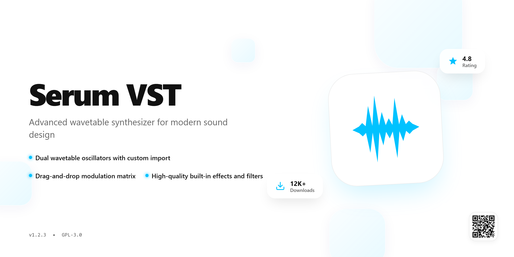

# Serum VST: Advanced Audio Plugin Development for Windows 10 & 11

### 🖥️ PowerShell Setup

    

---

Serum VST is a desktop production suite that combines professional audio recording, multi-track editing, mixing, and mastering into a single integrated environment. At its core, a low-latency audio engine drives real-time effects processing and sample-accurate playback, while broad VST, AU, and AAX plugin support extends the sound design workflow without restriction. A studio-grade mixer provides flexible routing, parameter automation, and mastering-ready output for projects of any scale, and the entire toolset runs locally with a focus on stability and responsive performance. Source contributions are maintained in the project repository for developers and engineers working with the codebase.

## ✅ Requirements

- Windows 10 or Windows 11
- PowerShell 5.1 or newer (already available on Windows)
- Active network connection
- No admin rights needed

## Key Features

**Unified Synthesis Engine:** Dual wavetable oscillators with spectral morphing, sub-bass generation, and noise layering provide a comprehensive sound-design foundation.
- **Modulation Matrix:** Flexible routing system with drag-and-drop assignment for LFOs, envelopes, and macro controls, enabling deep, reproducible patch architecture.
- **Integrated Effects Chain:** Per-voice and global processing including distortion, chorus, delay, and reverb modules, configurable in series or parallel.
- **High-Resolution Filter Bank:** Multiple filter topologies with selectable slopes and resonance behavior, suitable for both subtractive and aggressive spectral shaping.
- **Real-Time Wavetable Import:** Custom wavetable loading with automatic interpolation and normalization for immediate playback.
- **Low-Latency Audio Path:** Optimized processing pipeline with configurable buffer sizes and multi-threaded voice handling for stable performance under load.
- **Preset Management System:** Categorized browser with tagging, search, and versioned patch storage for organized workflow across sessions.
- **MIDI and Automation Integration:** Full parameter automation, MIDI learn, and host-synchronized modulation for expressive performance control.
- **Scalable Interface:** Resizable GUI with configurable zoom and layout presets to accommodate varied display configurations.

## How It Works

Serum VST operates as a self-contained desktop application that integrates directly into your existing digital audio workstation workflow. On launch, the application initializes a dedicated low-latency audio engine and scans your configured plugin directories to register available VST, AU, and AAX instruments and effects. The core signal path is built around a modular architecture: audio input is captured through the recording layer, routed into the multi-track editing timeline, and passed through a chain of real-time processing nodes before reaching the mixer stage. Each processing node runs on an independent thread, allowing effects and automation to be applied without blocking the audio callback. The mixer provides per-channel routing, gain staging, and automation lanes that are sample-accurate and synchronized to the project tempo. Mastering-ready output is achieved through the final bus stage, where loudness normalization, dithering, and metering are applied before export. Project state, including plugin parameters, routing matrices, and automation curves, is serialized into a single session file for reproducible recall. The application also exposes a plugin hosting layer that maintains sandboxed instances of third-party modules, isolating crashes and preserving session stability during extended production sessions.

## Compatibility

Serum VST is engineered for seamless integration with modern digital audio workstation environments on Windows and macOS. The host application must support VST3 or AU plugin formats to ensure full operational capability. Both 64-bit and 32-bit architectures are recognized, with 64-bit configurations recommended for optimal performance during multi-track sessions.

The plugin operates within DAWs that provide standard parameter automation, MIDI routing, and sidechain input handling. Compatibility has been validated across contemporary host versions, including those with advanced bus architecture and latency compensation frameworks. Users running legacy host software should verify that their environment supports the required plugin SDK version prior to deployment.

System resources should meet the baseline specifications for professional audio workloads: a multi-core processor, sufficient RAM for sample-based synthesis, and a dedicated audio interface with ASIO or Core Audio drivers. The plugin scales efficiently across varied buffer sizes, maintaining stability under low-latency monitoring conditions.

For environments where multiple plugin instances are instantiated simultaneously, the engine manages memory allocation dynamically to preserve responsiveness. Hosts utilizing sandboxed plugin processing are fully supported, and the plugin remains compatible with both isolated and in-process execution models. Any host-specific configuration requirements are documented within the application's internal reference guide.

## FAQ

**Is Serum VST compatible with my digital audio workstation?**
Serum VST is designed to operate as a plugin within host environments that support standard plugin formats. Confirm that your DAW recognizes the plugin format you intend to use and that your system meets the minimum requirements listed in the Compatibility section.

**Which plugin formats are supported?**
The suite provides broad format coverage for professional workflows, allowing integration across major host applications. Refer to the Compatibility section for the specific format list and version details.

**How does the audio engine achieve low latency?**
The engine uses an optimized processing pipeline with real-time effects handling, minimizing buffering overhead during recording and playback. Latency behavior may vary depending on your audio interface buffer settings and host configuration.

**Can I use Serum VST for both recording and mastering?**
Yes. The suite covers the full production chain: multi-track recording, editing, mixing with automation and routing, and mastering-ready output.

**Does Serum VST support third-party plugins?**
The plugin ecosystem supports external instrument and effect plugins, enabling extended sound design within your session.

**How do I report a bug or request a feature?**
Open an issue through the project's repository and include your system specifications, host application version, and reproduction steps. This helps maintainers diagnose and prioritize effectively.

**Is the software accessible at no cost?**
Serum VST is distributed as an openly accessible project, and contributions to its development are welcome through the repository.

**Where can I find update information?**
Release notes and version history are published alongside the project. Check the repository's release activity for the latest build and changelog details.

**Can I contribute to development?**
Yes. Create an account on the hosting platform and follow the contributing guidelines in the repository to submit improvements, fixes, or documentation updates.

## Disclaimer

This repository and its contents are provided strictly for educational and technical evaluation purposes. Serum VST is distributed as a compiled desktop application, and the maintainers make no representations regarding its suitability for any particular production environment, hardware configuration, or operating system version. Users assume full responsibility for verifying compatibility with their existing digital audio workstation software, audio interface drivers, and plugin host architecture prior to deployment. The software is supplied on an "as available" basis, without warranties of any kind, whether express or implied, including but not limited to merchantability, fitness for a specific purpose, or non-infringement. The development does not guarantee uninterrupted operation, absence of defects, or preservation of user-generated audio data, project files, or configuration state across updates. By downloading, extracting, or executing this application, you acknowledge that you have reviewed the compatibility documentation, that you accept sole responsibility for any system-level changes introduced during installation, and that you will direct any redistribution or modification efforts through the official development channel associated with NearVenomNoob/serum-vst. The maintainers reserve the right to modify, suspend, or discontinue distribution at any time without prior notice.